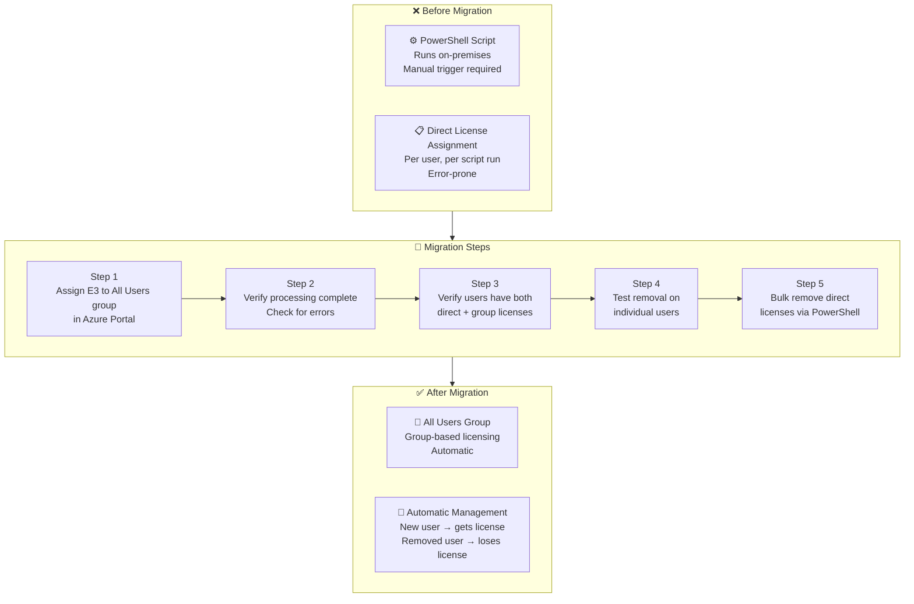
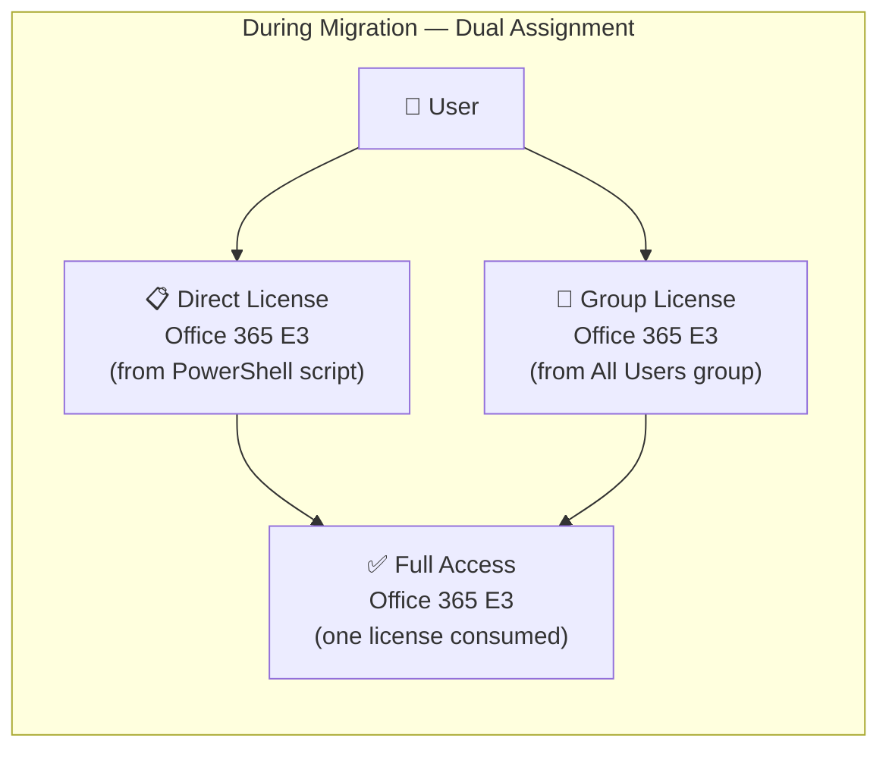
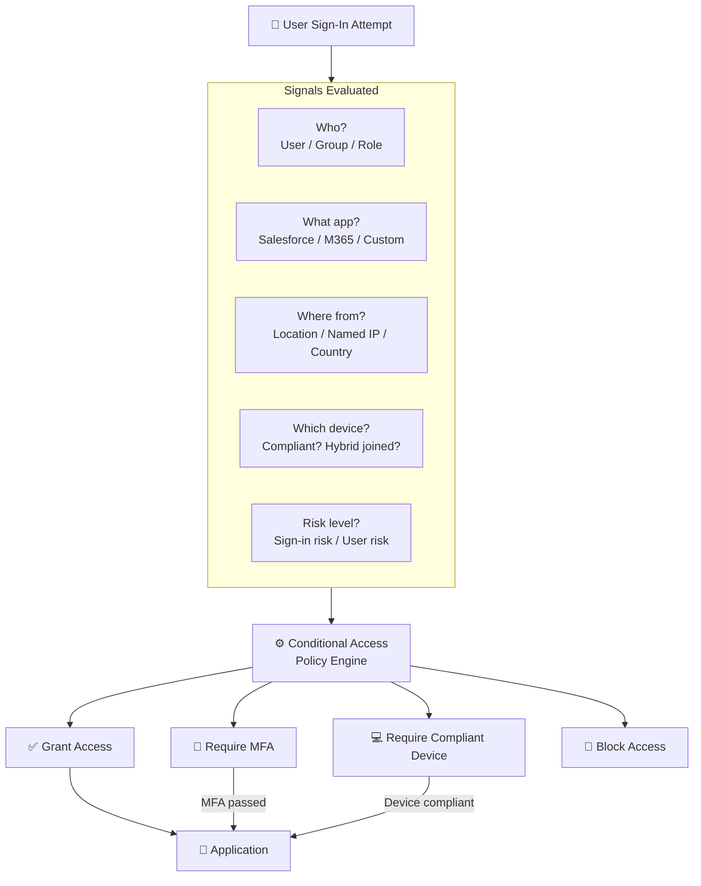
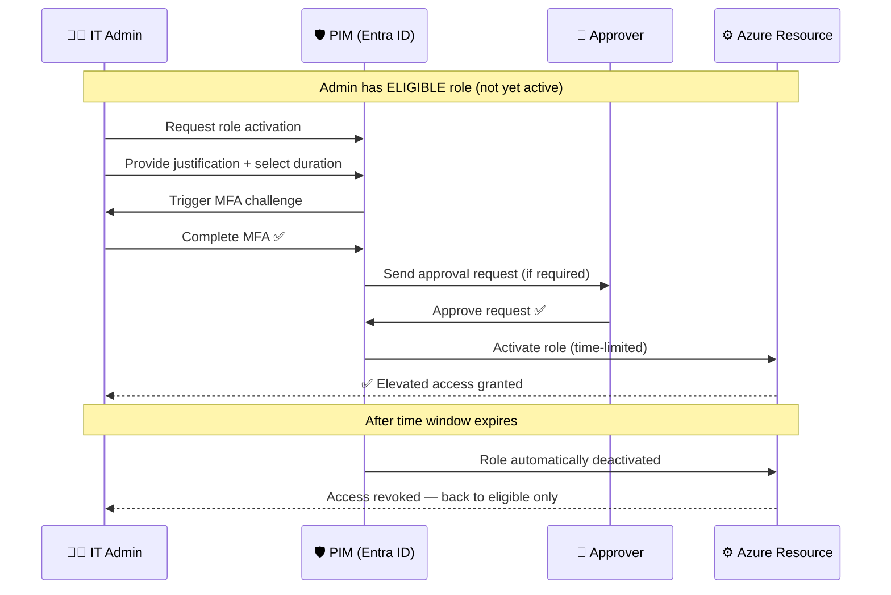
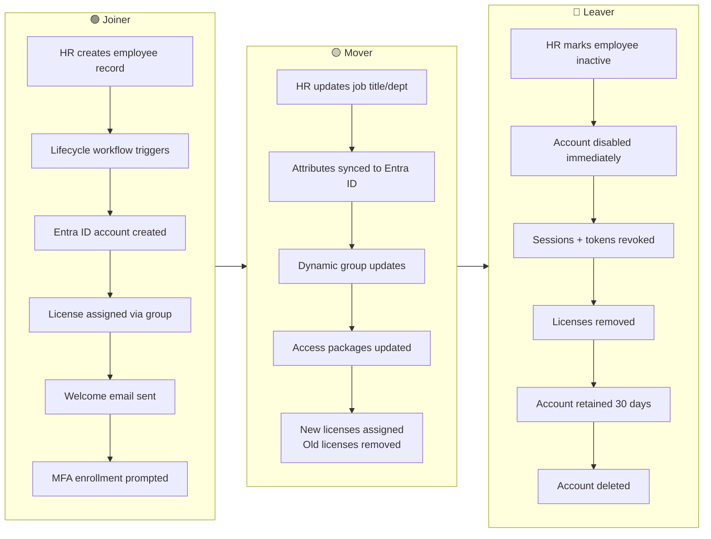
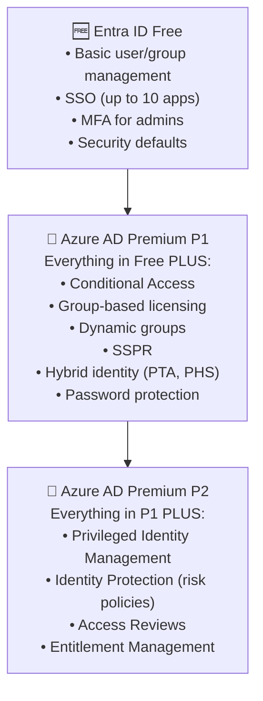

# SC-300 Architecture Diagrams

Mermaid diagrams for key SC-300 concepts.
Renders natively on GitHub or at [mermaid.live](https://mermaid.live).

---

## Diagram 1: Group-Based Licensing Migration Flow

---

## Diagram 2: User License State During Migration

---

## Diagram 3: Conditional Access Policy Evaluation

---

## Diagram 4: Privileged Identity Management (PIM) Flow

---

## Diagram 5: Identity Lifecycle — Joiner Mover Leaver

---

## Diagram 6: Entra ID License Tiers — Feature Comparison

